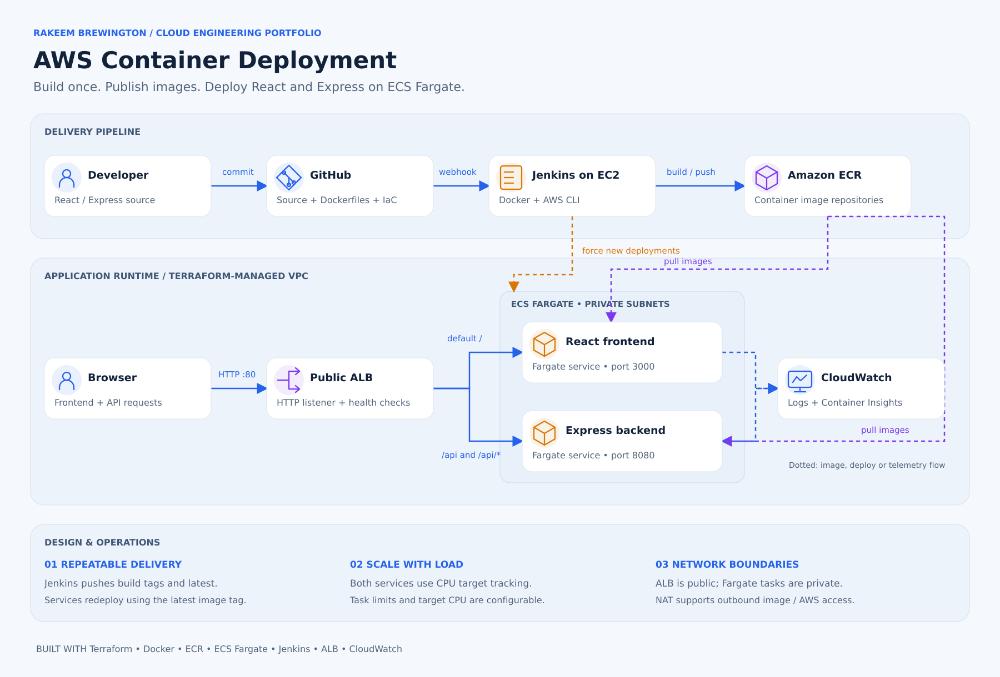

# AWS ECS Fargate — Containerized Application and Jenkins CI/CD

Deployment of a React frontend and Express backend to AWS ECS Fargate using Docker, Terraform, Jenkins, ECR, an Application Load Balancer, and ECS Service Auto Scaling.

## Project at a glance

**Business scenario:** A two-tier web application needs repeatable releases, reliable routing, and room to handle traffic increases without manually managing servers.

**What I built:** Containerized a React frontend and Express API using Docker, published the images to Amazon ECR, and deployed both services on ECS Fargate behind an Application Load Balancer. Terraform defines the AWS infrastructure; Jenkins automates the build-and-deploy workflow.

**Verified outcomes**
- Deployed and checked two separately containerized application services.
- Validated frontend scaling from **one to two ECS tasks** during a load test.
- Diagnosed and fixed frontend-to-backend API routing, then verified application responses.

**Key decisions:** Fargate reduces server administration; the ALB provides path-based routing and health checks; Terraform makes environments reproducible; Jenkins reduces repetitive release steps.

**Production improvements to prioritize:** HTTPS with ACM and a domain, image digest pinning, stronger release rollback controls, and actionable service-level alerts.

**Stack:** AWS ECS Fargate · ECR · ALB · CloudWatch · Terraform · Docker · Jenkins · React · Express

**Explore:** [Architecture](#architecture) · [Infrastructure](#aws-infrastructure) · [Source code](https://github.com/Rakeem08/aws-ecs-containerized-app-cicd)

> **Portfolio environment:** Deployment addresses below document the original lab. They are not guaranteed to be active endpoints.

## Application URLs

- Frontend: http://rakeem-devops-alb-38784143.us-east-1.elb.amazonaws.com
- Backend API: http://rakeem-devops-alb-38784143.us-east-1.elb.amazonaws.com/api
- Jenkins: http://3.215.173.240:8080

Jenkins credentials are provided privately in the submission form and are not stored in this repository.

## Architecture



[Open the full-size architecture graphic](docs/images/ecs-architecture.svg)

The public ALB routes the default path to the React service and `/api` to the Express service. Both Fargate services run in private subnets. Jenkins builds and pushes the images, forces new service deployments, and waits for stability. Dotted arrows show deployment, image, or telemetry flow. The current task definitions use `:latest`; the pipeline also publishes build-number tags.

## AWS Infrastructure

Terraform provisions:

- One VPC
- Two public subnets
- Two private subnets
- Internet Gateway
- NAT Gateway
- Public Application Load Balancer
- Frontend and backend target groups
- ECS cluster running with Fargate
- Frontend and backend ECS services
- Frontend and backend ECR repositories
- CloudWatch log groups
- IAM roles and policies
- Security groups
- Jenkins EC2 server with an Elastic IP
- ECS Service Auto Scaling

## ECS Configuration

Each frontend and backend task uses:

- Launch type: Fargate
- CPU: 512 CPU units or 0.5 vCPU
- Memory: 1024 MB or 1 GB
- Minimum tasks: 1
- Desired tasks: 1
- Maximum tasks: 4
- CPU scaling target: 50%

## Repository Structure

```text
.
├── backend/
│   ├── Dockerfile
│   ├── config.js
│   └── index.js
├── frontend/
│   ├── Dockerfile
│   └── src/
├── load-test/
│   └── load-test.js
├── terraform/
│   ├── alb.tf
│   ├── autoscaling.tf
│   ├── ecr.tf
│   ├── ecs.tf
│   ├── iam.tf
│   ├── jenkins.tf
│   ├── network.tf
│   ├── outputs.tf
│   ├── provider.tf
│   ├── security-groups.tf
│   ├── terraform.tfvars.example
│   └── variables.tf
├── Jenkinsfile
└── README.md
```

## Prerequisites

Install the following tools:

- Git
- Node.js 16
- npm
- Docker Desktop
- Terraform
- AWS CLI
- An AWS account with the required permissions
- An existing EC2 key pair

Configure AWS CLI:

```powershell
aws configure
aws sts get-caller-identity
```

## Run the Application Locally

Clone the repository:

```powershell
git clone https://github.com/Rakeem08/cloud-engineer-tech-challenge-1.git
cd cloud-engineer-tech-challenge-1
```

### Backend

```powershell
cd backend
npm ci
npm start
```

The backend will be available at:

```text
http://localhost:8080
```

### Frontend

Open another terminal:

```powershell
cd frontend
npm ci
npm start
```

The frontend will be available at:

```text
http://localhost:3000
```

A successful connection displays `SUCCESS` followed by a GUID.

## Run with Docker

From the repository root, build both images:

```powershell
docker build -t backend-app .\backend
docker build --build-arg REACT_APP_API_URL=http://localhost:8080 -t frontend-app .\frontend
```

Run both containers:

```powershell
docker run -d --name backend -p 8080:8080 backend-app
docker run -d --name frontend -p 3000:3000 frontend-app
```

Verify:

```powershell
docker ps
```

Open:

```text
http://localhost:3000
```

Stop the containers:

```powershell
docker stop frontend backend
docker rm frontend backend
```

## Deploy the Infrastructure with Terraform

Create a private variables file:

```powershell
Copy-Item .\terraform\terraform.tfvars.example .\terraform\terraform.tfvars
```

Update `terraform/terraform.tfvars` with the public IP address permitted to SSH into Jenkins:

```hcl
ssh_allowed_cidr = "YOUR_PUBLIC_IP/32"
```

The real `terraform.tfvars`, Terraform state, saved plans, and private keys are ignored by Git.

Initialize and validate Terraform:

```powershell
terraform -chdir=terraform init
terraform -chdir=terraform fmt -recursive
terraform -chdir=terraform validate
```

### ECR Bootstrap

Create the repositories before starting ECS:

```powershell
terraform -chdir=terraform apply -target="aws_ecr_repository.frontend" -target="aws_ecr_repository.backend" -target="aws_ecr_lifecycle_policy.frontend" -target="aws_ecr_lifecycle_policy.backend"
```

Load the repository addresses:

```powershell
$frontendEcr = terraform -chdir=terraform output -raw frontend_ecr_url
$backendEcr = terraform -chdir=terraform output -raw backend_ecr_url
$registry = ($frontendEcr -split "/")[0]
```

Authenticate Docker with ECR:

```powershell
aws ecr get-login-password --region us-east-1 | docker login --username AWS --password-stdin $registry
```

Build, tag, and push the initial images:

```powershell
docker build --build-arg REACT_APP_API_URL=/api -t frontend-app .\frontend
docker build -t backend-app .\backend

docker tag frontend-app:latest "${frontendEcr}:latest"
docker tag backend-app:latest "${backendEcr}:latest"

docker push "${frontendEcr}:latest"
docker push "${backendEcr}:latest"
```

Create a fresh Terraform plan and apply it:

```powershell
terraform -chdir=terraform plan -out=tfplan
terraform -chdir=terraform apply "tfplan"
```

Display the deployment outputs:

```powershell
terraform -chdir=terraform output
```

## Jenkins Infrastructure

Jenkins runs as a Docker container on an Amazon Linux 2023 EC2 instance.

The supporting infrastructure includes:

- EC2 instance in a public subnet
- Elastic IP address
- Security group for SSH and Jenkins port 8080
- Persistent Docker volume for Jenkins data
- EC2 IAM instance profile
- Docker socket mounted into the Jenkins container
- Docker CLI, AWS CLI, Git, and jq installed in the custom Jenkins image

The EC2 IAM role allows Jenkins to work with ECR and ECS without storing permanent AWS access keys inside Jenkins.

The private GitHub token is stored securely in Jenkins Credentials and is not included in this repository.

## Jenkins Pipeline

The `Jenkinsfile` automates:

1. Checking out the private GitHub repository
2. Verifying Docker, AWS CLI, and AWS identity
3. Authenticating with Amazon ECR
4. Building frontend and backend images
5. Tagging images with the Jenkins build number
6. Pushing images to ECR
7. Triggering new ECS service deployments
8. Waiting for both ECS services to become stable

The GitHub repository webhook sends push events to:

```text
http://JENKINS_PUBLIC_IP:8080/github-webhook/
```

Every push to `main` automatically starts the Jenkins deployment pipeline.

## Load Testing and Auto Scaling

Grafana k6 was used to test ECS Service Auto Scaling.

The test:

- Gradually increased traffic to 200 virtual users
- Sent requests to both `/` and `/api`
- Completed approximately 180,000 iterations
- Caused the frontend service to scale from one task to two tasks
- Returned the frontend service to one task after traffic stopped
- Confirmed the scaling activity completed successfully

Run the test from the repository root:

```powershell
$appUrl = terraform -chdir=terraform output -raw application_url
$loadTestPath = (Resolve-Path .\load-test).Path

docker run --rm `
  -e "BASE_URL=$appUrl" `
  --mount "type=bind,source=$loadTestPath,target=/scripts,readonly" `
  grafana/k6 run /scripts/load-test.js
```

Check the ECS task counts:

```powershell
aws ecs describe-services --cluster rakeem-devops-cluster --services rakeem-devops-frontend-service rakeem-devops-backend-service --region us-east-1 --query "services[].{Service:serviceName,Desired:desiredCount,Running:runningCount,Pending:pendingCount}" --output table
```

Check Auto Scaling activity:

```powershell
aws application-autoscaling describe-scaling-activities --service-namespace ecs --region us-east-1 --max-results 20 --query "ScalingActivities[?contains(ResourceId, 'rakeem-devops')].{Service:ResourceId,Action:Description,Status:StatusCode,Started:StartTime}" --output table
```

## Security

- ECS tasks run in private subnets.
- Only the load balancer can reach the ECS container ports.
- Jenkins uses an IAM role instead of permanent AWS credentials.
- SSH access is restricted to a configured public IP address.
- GitHub tokens are stored in Jenkins Credentials.
- Terraform state, private variable files, and private keys are excluded from Git.
- ECR image scanning is enabled.

## Cleanup

AWS resources in this project create charges. After grading is complete, remove the infrastructure:

```powershell
terraform -chdir=terraform plan -destroy -out=destroy.tfplan
terraform -chdir=terraform apply "destroy.tfplan"
```

Do not destroy the infrastructure before the project has been graded.

## Author

Rakeem Brewington