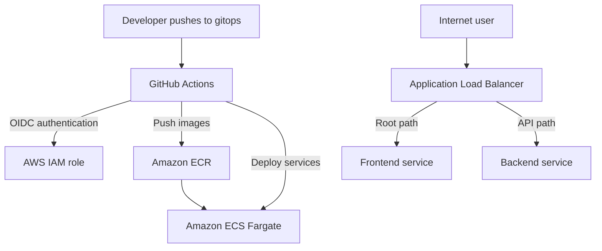

# Cloud Engineer Tech Challenge 1 — GitOps Alternative

Deployment of a React frontend and Express backend to AWS ECS Fargate using Docker, Terraform, GitHub Actions, OpenID Connect (OIDC), Amazon ECR, an Application Load Balancer, and ECS Service Auto Scaling.

This `gitops` branch contains the GitHub Actions CI/CD alternative. The `main` branch contains the required Jenkins deployment solution.

## Application URLs

- Frontend: [http://rakeem-devops-alb-38784143.us-east-1.elb.amazonaws.com](http://rakeem-devops-alb-38784143.us-east-1.elb.amazonaws.com)
- Backend API: [http://rakeem-devops-alb-38784143.us-east-1.elb.amazonaws.com/api](http://rakeem-devops-alb-38784143.us-east-1.elb.amazonaws.com/api)
- Jenkins for the `main` branch: [http://3.215.173.240:8080](http://3.215.173.240:8080)

Jenkins credentials are provided privately in the submission form and are not stored in this repository.

## Architecture



## AWS Infrastructure

Terraform provisions the following resources:

- One VPC
- Two public subnets
- Two private subnets
- Internet Gateway
- NAT Gateway
- Public Application Load Balancer
- Frontend and backend target groups
- ECS cluster running with AWS Fargate
- Frontend and backend ECS services
- Frontend and backend ECR repositories
- CloudWatch log groups
- IAM roles and policies
- Security groups
- Jenkins EC2 server with an Elastic IP
- ECS Service Auto Scaling
- GitHub Actions OIDC provider
- GitHub Actions deployment role and policy

The Jenkins resources support the required solution on the `main` branch. The GitHub Actions resources support the GitOps alternative on this branch.

## ECS Configuration

Each frontend and backend task uses:

- Launch type: Fargate
- CPU: 512 CPU units or 0.5 vCPU
- Memory: 1024 MB or 1 GB
- Minimum tasks: 1
- Desired tasks: 1
- Maximum tasks: 4
- CPU scaling target: 50%

## Repository Structure

```text
.github/
  workflows/
    deploy.yml
backend/
  Dockerfile
  config.js
  index.js
  package.json
  package-lock.json
frontend/
  Dockerfile
  public/
  src/
    App.js
    config.js
  package.json
  package-lock.json
load-test/
  load-test.js
terraform/
  alb.tf
  autoscaling.tf
  ecr.tf
  ecs.tf
  github-actions.tf
  iam.tf
  jenkins.tf
  network.tf
  outputs.tf
  provider.tf
  security-groups.tf
  terraform.tfvars.example
  variables.tf
README.md
```

The `Jenkinsfile` is intentionally not included in the `gitops` branch. It remains available on the `main` branch.

## Prerequisites

Install and configure the following tools:

- Git
- Node.js
- npm
- Docker Desktop
- Terraform
- AWS CLI
- Visual Studio Code
- An AWS account with the necessary permissions
- An existing EC2 key pair for Jenkins SSH access

Confirm the tools are installed:

```powershell
git --version
node --version
npm --version
docker --version
terraform -version
aws --version
```

Confirm AWS authentication:

```powershell
aws sts get-caller-identity
```

## Clone the Repository

```powershell
git clone https://github.com/Rakeem08/cloud-engineer-tech-challenge-1.git
```

Enter the project:

```powershell
cd cloud-engineer-tech-challenge-1
```

Switch to the GitOps branch:

```powershell
git switch gitops
```

## Run the Application Locally

### Backend

Open a VS Code terminal:

```powershell
cd backend
npm ci
npm start
```

The backend listens on:

```text
http://localhost:8080
```

Opening that address should return an object containing a generated GUID.

### Frontend

Keep the backend running and open a second VS Code terminal:

```powershell
cd frontend
npm ci
npm start
```

The frontend is available at:

```text
http://localhost:3000
```

A generated GUID on the frontend confirms that it successfully communicated with the backend.

## Run with Docker

Start Docker Desktop before running these commands.

From the project root, build the backend:

```powershell
docker build -t backend-app .\backend
```

Build the frontend:

```powershell
docker build --build-arg REACT_APP_API_URL=http://localhost:8080 -t frontend-app .\frontend
```

Run the backend container:

```powershell
docker run -d --name backend -p 8080:8080 backend-app
```

Run the frontend container:

```powershell
docker run -d --name frontend -p 3000:3000 frontend-app
```

Confirm both containers are running:

```powershell
docker ps
```

Open:

```text
http://localhost:3000
```

Stop the containers when testing is finished:

```powershell
docker stop frontend backend
```

Remove the stopped containers if necessary:

```powershell
docker rm frontend backend
```

## Terraform Configuration

Change to the Terraform directory:

```powershell
cd terraform
```

Copy the example variables file:

```powershell
Copy-Item terraform.tfvars.example terraform.tfvars
```

Edit `terraform.tfvars` and replace all placeholder values.

The SSH CIDR should contain the administrator’s public IP followed by `/32`. For example:

```hcl
ssh_allowed_cidr = "203.0.113.10/32"
```

Do not use the example IP above. Use the actual public IP of the administrator running Terraform.

Do not commit:

- `terraform.tfvars`
- Terraform state files
- `.pem` private keys
- GitHub tokens
- AWS credentials
- Jenkins passwords

## Initialize and Validate Terraform

From the `terraform` directory:

```powershell
terraform init
```

```powershell
terraform fmt
```

```powershell
terraform validate
```

A successful validation displays:

```text
Success! The configuration is valid.
```

## ECR Bootstrap

The frontend and backend container repositories must exist before the initial Docker images can be pushed.

Create the ECR resources:

```powershell
terraform apply -target="aws_ecr_repository.frontend" -target="aws_ecr_repository.backend" -target="aws_ecr_lifecycle_policy.frontend" -target="aws_ecr_lifecycle_policy.backend"
```

Type `yes` when prompted.

Return to the project root:

```powershell
cd ..
```

Read the ECR repository URLs:

```powershell
$frontendEcr = terraform -chdir=terraform output -raw frontend_ecr_url
$backendEcr = terraform -chdir=terraform output -raw backend_ecr_url
$registry = ($frontendEcr -split "/")[0]
```

Authenticate Docker with Amazon ECR:

```powershell
aws ecr get-login-password --region us-east-1 | docker login --username AWS --password-stdin $registry
```

Build the initial backend image:

```powershell
docker build -t backend-app .\backend
```

Build the initial frontend image:

```powershell
docker build --build-arg REACT_APP_API_URL=/api -t frontend-app .\frontend
```

Tag both images:

```powershell
docker tag frontend-app:latest "${frontendEcr}:latest"
docker tag backend-app:latest "${backendEcr}:latest"
```

Push both images:

```powershell
docker push "${frontendEcr}:latest"
docker push "${backendEcr}:latest"
```

The `-target` option is used only for the initial ECR bootstrap. Normal Terraform deployments should use a complete plan and apply.

## Deploy the Complete Infrastructure

Change to the Terraform directory:

```powershell
cd terraform
```

Create a Terraform plan:

```powershell
terraform plan -out=tfplan
```

Review the plan carefully. Then apply it:

```powershell
terraform apply tfplan
```

Display the Terraform outputs:

```powershell
terraform output
```

The outputs include:

- Application URL
- Backend URL
- ALB DNS name
- ECR repository URLs
- ECS cluster name
- ECS service names
- Jenkins URL
- Jenkins public IP
- VPC and subnet IDs

Return to the project root:

```powershell
cd ..
```

## GitHub Actions OIDC Authentication

GitHub Actions authenticates with AWS using OpenID Connect.

OIDC allows GitHub Actions to request temporary AWS credentials. Permanent AWS access keys are not stored in GitHub.

Terraform creates:

- GitHub OIDC identity provider
- GitHub Actions IAM role
- IAM trust policy
- ECR deployment permissions
- ECS deployment permissions

The IAM trust policy allows only this repository’s `gitops` branch to assume the deployment role.

The immutable GitHub repository and owner IDs prevent a renamed or recycled repository from using the AWS role.

## GitHub Actions GitOps Pipeline

The workflow is located at:

```text
.github/workflows/deploy.yml
```

The workflow runs automatically when code is pushed to:

```text
gitops
```

It can also be started manually using `workflow_dispatch`.

The pipeline performs these steps:

1. Checks out the `gitops` branch.
2. Requests temporary AWS credentials through OIDC.
3. Verifies the AWS identity.
4. Authenticates with Amazon ECR.
5. Builds the frontend Docker image.
6. Builds the backend Docker image.
7. Tags each image with the Git commit SHA and `latest`.
8. Pushes both images to Amazon ECR.
9. Forces a new backend ECS deployment.
10. Forces a new frontend ECS deployment.
11. Waits until both ECS services become stable.
12. Reports a successful deployment.

No permanent AWS credentials are stored in GitHub Actions secrets.

## Test the GitOps Pipeline

Make a safe change on the `gitops` branch and commit it:

```powershell
git add .
```

```powershell
git commit -m "Test GitOps deployment"
```

```powershell
git push
```

Open the repository on GitHub and select:

```text
Actions → Deploy to Amazon ECS
```

A successful run should show green checkmarks for all workflow steps.

After the workflow succeeds, open the application URL and confirm the frontend displays a generated GUID.

## Jenkins Solution

The required Jenkins pipeline is stored on the `main` branch.

Switch to the Jenkins solution with:

```powershell
git switch main
```

The `main` branch contains:

- `Jenkinsfile`
- Jenkins deployment documentation
- GitHub webhook configuration
- Docker image build and push stages
- ECS deployment stages

Do not merge the `gitops` branch into `main`. Keeping the branches separate preserves the two required deployment approaches.

## Load Testing and Auto Scaling

Grafana k6 is used to test ECS Service Auto Scaling.

Run the load test with a locally installed k6 command:

```powershell
k6 run .\load-test\load-test.js
```

Alternatively, use the k6 Docker image:

```powershell
Get-Content .\load-test\load-test.js -Raw | docker run --rm -i grafana/k6 run -
```

The test:

- Gradually increases traffic to 200 virtual users
- Sends requests to the application
- Produces sustained CPU activity
- Allows the frontend service to scale beyond one task
- Stops traffic so the service can eventually scale back down

Check the ECS service task counts:

```powershell
aws ecs describe-services --cluster rakeem-devops-cluster --services rakeem-devops-frontend-service rakeem-devops-backend-service --region us-east-1 --query "services[].{Service:serviceName,Desired:desiredCount,Running:runningCount,Pending:pendingCount}" --output table
```

Check scaling activity:

```powershell
aws application-autoscaling describe-scaling-activities --service-namespace ecs --region us-east-1 --max-results 20 --output table
```

The completed load test demonstrated the frontend service scaling from one task to two tasks.

## Security

Security controls include:

- Frontend and backend ECS tasks run in private subnets.
- The Application Load Balancer is the public entry point.
- Security groups restrict traffic between resources.
- SSH access is restricted to one administrator IP using `/32`.
- ECS task roles use IAM permissions.
- GitHub Actions uses temporary OIDC credentials.
- The GitHub Actions IAM role follows least-privilege principles.
- GitHub access tokens are not stored in the repository.
- AWS access keys are not stored in the repository.
- Jenkins credentials are not stored in the repository.
- Terraform variable and state files are ignored by Git.
- Private `.pem` files are not committed.

## Verification Checklist

Before submission, confirm:

- The frontend URL opens successfully.
- The frontend displays a generated GUID.
- The backend `/api` route returns JSON containing a GUID.
- Both ECS services show the desired number of running tasks.
- The Jenkins pipeline succeeds on the `main` branch.
- The GitHub Actions workflow succeeds on the `gitops` branch.
- Auto Scaling has minimum 1, desired 1, and maximum 4 tasks.
- The CPU scaling target is 50%.
- Terraform validation succeeds.
- The repository is private.
- The instructor has access to the private repository.
- No credentials, private keys, state files, or tokens are committed.

## Submission Information

Provide the following in the submission form:

- Private GitHub repository URL
- Deployed frontend application URL
- Jenkins server URL
- Jenkins username and password

Do not place the Jenkins password or GitHub token inside the README.

The repository must be shared with:

```text
michaeltayo96@outlook.com
```

Screenshots are stored in the separate personal Word document and are not committed to this repository.

## Cleanup

Do not destroy the infrastructure before the project has been graded.

After grading is complete, change to the Terraform directory:

```powershell
cd terraform
```

Preview the resources that will be removed:

```powershell
terraform plan -destroy
```

Remove the AWS infrastructure:

```powershell
terraform destroy
```

Type `yes` only after confirming that grading is complete and the resources are no longer required.

## Author

Rakeem Brewington